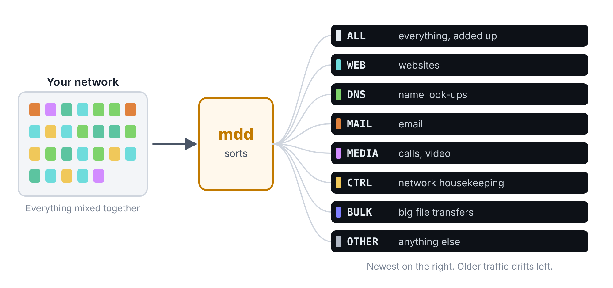
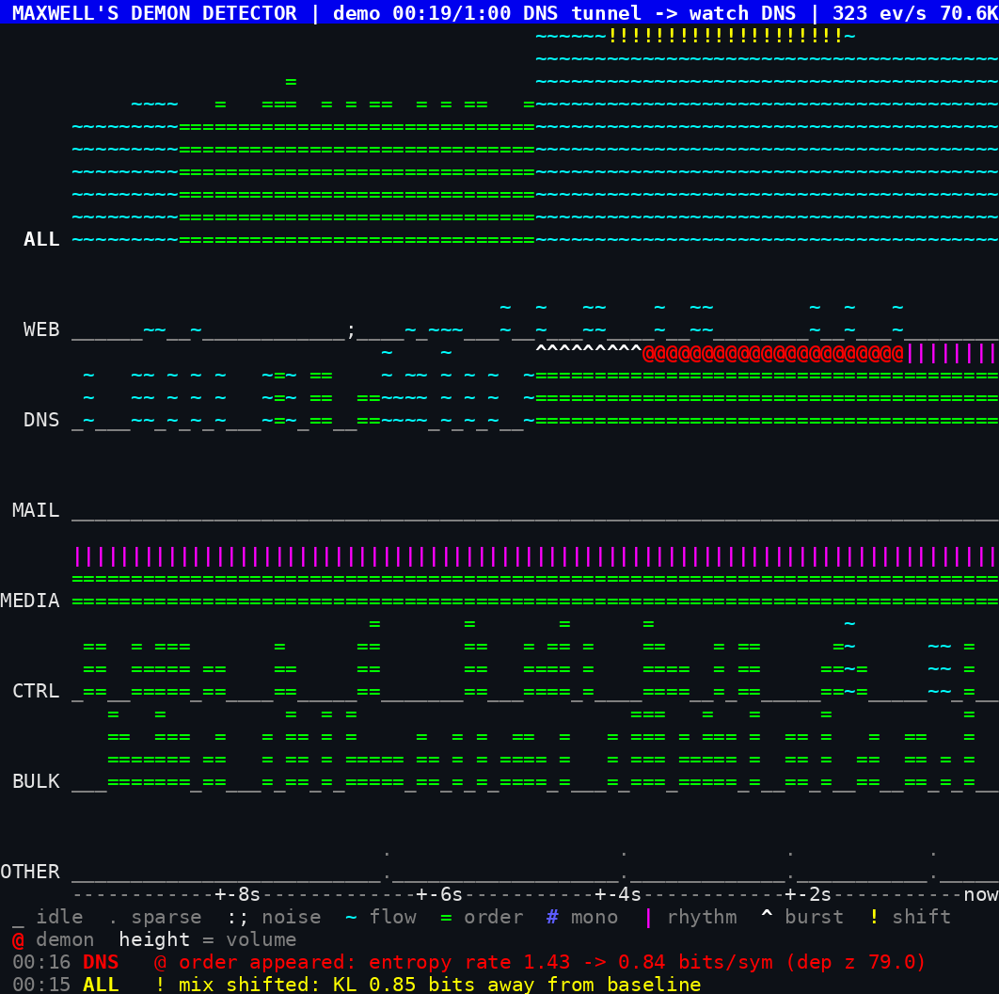
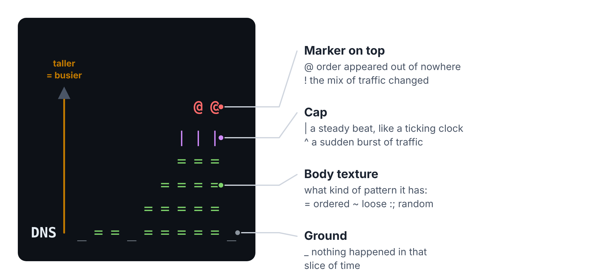
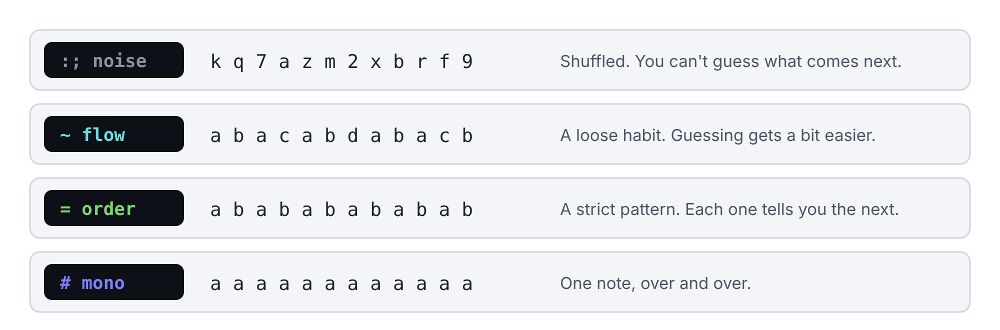
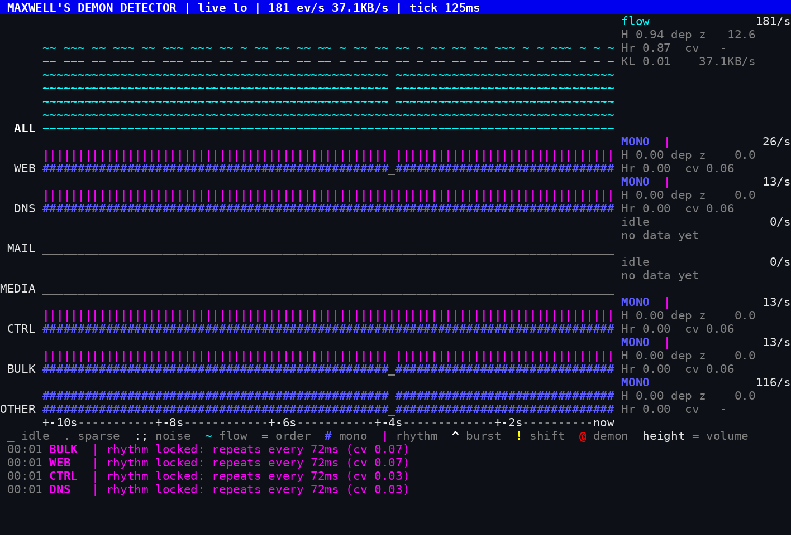

# Maxwell’s Demon Detector

*Watch the patterns in your network traffic as a river split into racing lanes, and spot the moment something starts behaving like a machine.*

Maxwell’s Demon Detector 0.4.0 · a quickstart guide from whispr.dev

Maxwell’s Demon Detector is a bit like a cross between Wireshark and the waterfall display on a radio scanner. If you’ve never seen either, picture a river flowing across your screen. The river is your network traffic. It’s split into lanes, like runners in a race, and each runner is a different kind of traffic. You watch the shape of each lane change, and the program puts a red `@` over the moment something starts to look too neat to be natural.

## What it does, in one minute

Everything your computer sends or receives over the internet is chopped into small parcels called **packets**. Think of them as envelopes. Each envelope has a few things written on the outside: how big it is, which way it’s going, and what kind of service it’s for (websites, email, a video call and so on).

Maxwell’s Demon Detector reads **only the outside of the envelopes**. It never opens them, so it doesn’t matter whether the contents are encrypted. It sorts the envelopes into lanes, then asks four simple questions about each lane, several times a second:

- **How busy is it?** More traffic makes the lane taller.
- **How mixed is it?** A random jumble looks different from a neat repeating pattern.
- **Is there a beat?** Some traffic arrives like a ticking clock.
- **Has it changed?** Each lane learns its own “normal” and notices when it stops looking like itself.

<figure>

<figcaption aria-hidden="true">Everything arrives mixed together. The program sorts it into lanes, and draws each lane as a strip on the screen.</figcaption>
</figure>

> **Think of it like this**
>
> In the 1860s, the physicist James Clerk Maxwell imagined a tiny creature, a “demon”, guarding a door between two boxes of gas. It let fast molecules one way and slow ones the other, turning a random mess into neat order. In real life, order doesn’t appear out of nowhere: something has to be doing the sorting. That’s the idea behind the name. When a lane of traffic suddenly becomes far more orderly than usual, something is probably making it that way, and the program flags it with `@`.

> **Words you'll meet**
>
> **Packet:** one small parcel of internet traffic. A web page arrives as dozens of them.
>
> **Lane:** one strip of the landscape, holding one kind of traffic. `ALL` at the top adds every lane together.
>
> **Tick:** one slice of time. By default the landscape adds a new column every eighth of a second.
>
> **Noise:** traffic with no pattern you could guess. Most normal traffic looks like this.
>
> **Order:** traffic so regular that each packet tells you what the next one will be.
>
> **Learning:** for the first few seconds, each lane is still working out what its normal looks like, so it doesn’t raise alarms yet.

## Get it on your computer

The program is free. It’s called `mdd` once it’s installed. Download it from **skeletrace.com/works-with**, or from the **Releases** page of github.com/whisprer-specops/maxwells-demon-detector.

| Your computer                           | Download                       | Then                                                                                                                                               |
|-----------------------------------------|--------------------------------|----------------------------------------------------------------------------------------------------------------------------------------------------|
| Windows 10 or 11                        | `mdd-windows-x86_64-setup.exe` | Double-click it. Windows may say “Windows protected your PC”, because the program isn’t code-signed yet. Click **More info**, then **Run anyway**. |
| Mac (Apple chip or Intel)               | `mdd-macos-universal.run`      | Open Terminal and type `sh ~/Downloads/mdd-macos-universal.run`                                                                                    |
| Linux (most PCs)                        | `mdd-linux-x86_64.run`         | Open a terminal and type `sh ~/Downloads/mdd-linux-x86_64.run`                                                                                     |
| Linux on ARM (e.g. Raspberry Pi 4 or 5) | `mdd-linux-aarch64.run`        | As above, with that file name                                                                                                                      |

Each installer shows the licence and asks you to accept it. On a Mac or Linux, press Space to page through it, then type `y`. It then asks which folder to use. Press Enter to take the suggested one:

| Your computer | Suggested folder                                |
|---------------|-------------------------------------------------|
| Windows       | `%LOCALAPPDATA%\Programs\MaxwellsDemonDetector` |
| Mac           | `~/Applications/MaxwellsDemonDetector`          |
| Linux         | `~/MaxwellsDemonDetector`                       |

The installer changes nothing else on your computer: no registry entries, no system settings. To remove the program, delete its folder.

> **Tip**
>
> This program runs in a **terminal**, the text window where you type commands. On Windows, use **Windows Terminal** (search for “Terminal” in the Start menu). It shows the colours properly and draws smoothly. The older black Command Prompt window works, but looks worse.

## Your first minute: the built-in demo

The demo needs no setup, no internet and no special permissions. It plays a scripted 60-second story, so you can learn what each pattern looks like before you watch real traffic.

1.  Open a terminal and go to the program’s folder. On Windows:

    ``` powershell
    cd "$env:LOCALAPPDATA\Programs\MaxwellsDemonDetector"
    .\mdd.exe
    ```

    On a Mac, type `cd ~/Applications/MaxwellsDemonDetector`, then `./mdd`. On Linux, `cd ~/MaxwellsDemonDetector`, then `./mdd`.

2.  Watch the title bar. It says `learning` for the first few seconds. That’s each lane getting to know its own normal.

3.  Follow the story in the table below. Press `q` when you’ve seen enough.

| When             | What happens                                                    | Where to look                                                                                                  |
|------------------|-----------------------------------------------------------------|----------------------------------------------------------------------------------------------------------------|
| The whole time   | A voice call, sending 50 packets a second each way              | `MEDIA`: a solid `=` with a fence of `\|` on top. It’s ordered, but that’s normal for a call, so there’s no `@` |
| 0 to 15 seconds  | Ordinary background traffic: web, email, look-ups               | Every lane learns what normal looks like                                                                       |
| 15 to 25 seconds | A “DNS tunnel”: someone sneaking data out through name look-ups | `DNS` jumps up (`^`), turns rigidly ordered (`=`) and gets a red `@`                                           |
| 30 to 42 seconds | A “beacon”: hidden software checking in every 0.4 seconds       | `OTHER` grows a steady `\|` beat                                                                                |
| 48 to 54 seconds | A flood of identical packets: a large copy-out of data          | `BULK` turns to `#`, with `^`, `!` and `@`                                                                     |

<figure>

<figcaption aria-hidden="true">The demo at about 20 seconds. The DNS lane has gone rigidly ordered (green <code>=</code>) and carries the red <code>@</code> row. MEDIA’s call shows the same order with a steady <code>|</code> beat, but no <code>@</code>: order that’s normal for a lane isn’t flagged.</figcaption>
</figure>

## How to read the landscape

Time flows **from right to left**. The newest slice of time is the column on the right, and older columns drift off to the left, like a waterfall turned on its side. Each column in a lane is built from three parts.

<figure>

<figcaption aria-hidden="true">One lane, built up column by column. Height shows how busy the lane is. The symbols show what kind of pattern the traffic has.</figcaption>
</figure>

**Height** means “busy compared with this lane’s usual”. A normal moment fills about two-thirds of the band; twice the usual fills it to the top. So a quiet lane and a busy lane can both look tall: each is measured against itself. The real numbers, in packets per second, are in the panel on the right.

**The body symbol** tells you how mixed the traffic is. This is the heart of the program, so here it is with letters instead of packets:

<figure>

<figcaption aria-hidden="true">Four kinds of stream. The more you can guess what comes next, the more ordered it is.</figcaption>
</figure>

Here is every symbol in one place:

| Symbol          | Name   | What it means, plainly                                  |
|-----------------|--------|---------------------------------------------------------|
| `_`             | idle   | Nothing happened in this lane during this slice of time |
| `.`             | sparse | Too little traffic to judge yet                         |
| `:` `;` `'` `,` | noise  | Mixed up, no pattern. Most everyday traffic             |
| `~`             | flow   | A loose pattern: real, but not strict                   |
| `=`             | order  | A strict pattern: each packet predicts the next         |
| `#`             | mono   | One kind of packet, over and over                       |
| `\|`             | rhythm | Packets arrive like a ticking clock                     |
| `^`             | burst  | Far more traffic than this lane usually has             |
| `!`             | shift  | The mix of packet sizes and directions has changed      |
| `@`             | demon  | Order has appeared that wasn’t there before             |

> **Tip**
>
> Press `l` to hide or show the symbol key at the bottom of the screen. The alert list underneath it keeps the latest alerts, with the time each one fired.

## Watch your own traffic, live

Watching live is called **live capture**. Your computer needs permission to look at network traffic, so this part takes one extra step on each system.

| Your computer | What you need                                                                                                              | How to give permission                                                                                                                                      |
|---------------|----------------------------------------------------------------------------------------------------------------------------|-------------------------------------------------------------------------------------------------------------------------------------------------------------|
| Windows       | **Npcap**, a free helper that lets programs see network traffic. Wireshark usually installs it, so you may have it already | Often none. If `mdd` says it has no permission, open the terminal as Administrator: right-click the Start button, choose **Terminal (Admin)**, then **Yes** |
| Mac           | Nothing extra                                                                                                              | Put `sudo` in front of the command, and type your Mac password when asked                                                                                   |
| Linux         | Nothing extra                                                                                                              | Put `sudo` in front of the command                                                                                                                          |

To get Npcap, go to **npcap.com**, choose **Download**, and run the installer with its normal settings. Then:

1.  Open a terminal and go to the program’s folder, as before. On a Mac or Linux, type `sudo` before each command below.

2.  See which network connections the program can watch:

    ``` powershell
    .\mdd.exe --mode list-interfaces
    ```

    The first line says which capture helper is in use. The list numbers each connection, and marks one as `default`: usually your Wi-Fi or your network cable.

3.  Start watching. With no extra options it uses the `default` connection:

    ``` powershell
    .\mdd.exe --mode live-pcap
    ```

4.  Open a few web pages, or start a video. `WEB` and `MEDIA` should rise, with `DNS` ticking along underneath.

To pick a different connection, add `--interface` with its number, or with a word from its description:

``` powershell
.\mdd.exe --mode live-pcap --interface 3
.\mdd.exe --mode live-pcap --interface wi-fi
```

To watch only one kind of traffic, add a **filter**. These are the same capture filters tcpdump and Wireshark use. (The Linux downloads understand the common forms shown here; `mdd` tells you if it doesn’t understand one.)

``` powershell
# Name look-ups only
.\mdd.exe --mode live-pcap --filter "udp port 53"
# Everything on TCP except remote logins
.\mdd.exe --mode live-pcap --filter "tcp and not port 22"
# One other device on your network
.\mdd.exe --mode live-pcap --filter "host 192.168.1.10"
```

<figure>

<figcaption aria-hidden="true">Live capture on a test machine while a small script fetched the same web page over and over. Machine-made traffic looks like this: every lane is a single repeated packet (<code>#</code>) with a steady beat (<code>|</code>). Your everyday browsing will look far more mixed.</figcaption>
</figure>

> **Heads-up**
>
> If the title bar ends with **“own traffic: promiscuous mode refused”**, your network card (usually Wi-Fi) won’t show other devices’ traffic. The program carries on and shows your own computer’s traffic, which is normal on Wi-Fi.

> **Tip**
>
> On a Mac or Linux you can skip typing `sudo` every time. On Linux, run `sudo setcap cap_net_raw,cap_net_admin=eip ./mdd` once, in the program’s folder.

## Other things it can watch

The landscape isn’t just for live traffic. It works on anything that flows.

**A saved capture file.** Wireshark saves `.pcapng` files; other tools save `.pcap`. Play one back, here at four times normal speed:

``` powershell
.\mdd.exe --mode pcap-file --input C:\temp\capture.pcapng --speed 4
```

Windows can make capture files with nothing installed, using its built-in `pktmon` tool. The full guide on GitHub has the steps.

**The raw bytes of any file.** This answers the original Maxwell’s demon question: where is the order hiding in this file? The lanes change to the kinds of byte inside it: `ZERO`, `CTRL` (control characters), `TEXT` (letters and digits), `HIGH` and `FF`.

``` powershell
.\mdd.exe --mode bytes --input C:\Windows\explorer.exe
```

A text file glows in the `TEXT` lane. Compressed or encrypted data looks like pure noise everywhere. Blocks of padding show up as `#` in `ZERO`.

**A log of events.** A CSV or JSON file with a `len` column (a size) and, ideally, a time column can be replayed with `--mode replay`. The full guide lists the columns.

## Keep a record of what you saw

Three options save what happens, so you can look again later or make graphs.

| Add this                    | What you get                                                                                                            |
|-----------------------------|-------------------------------------------------------------------------------------------------------------------------|
| `--alert-log alerts.csv`    | One line for every alert (`@ ! ^ \|`), the moment it fires, with the time and that lane’s numbers                        |
| `--metrics-log metrics.csv` | Every lane’s numbers, every slice of time: ready to open in Excel and turn into a chart                                 |
| `--record session.jsonl`    | The traffic itself (sizes, directions, times; never contents), so you can replay the whole session with `--mode replay` |

For example:

``` powershell
.\mdd.exe --mode live-pcap --alert-log C:\temp\alerts.csv --metrics-log C:\temp\metrics.csv
```

> **Heads-up**
>
> The metrics log grows by roughly 20 MB an hour at the normal speed. For long sessions, add `--tick-ms 1000` to take one slice a second. That cuts it to about 3 MB an hour.

## Keys while it’s running

| Key                    | What it does                                                                 |
|------------------------|------------------------------------------------------------------------------|
| `space`                | Pause. In live mode, analysis keeps running underneath, so nothing is missed |
| `+` and `-`            | Scroll faster or slower                                                      |
| `l`                    | Show or hide the symbol key                                                  |
| `c`                    | Colour on or off                                                             |
| `q`, `Esc` or `Ctrl+C` | Quit                                                                         |

## What it can and can’t tell you

> **What it can't tell you**
>
> **`@` means “more ordered than this lane usually is”. It doesn’t mean “bad”.** A video call is very ordered, and that’s fine. Each lane compares itself with its own recent past.
>
> **New normal wins after a while.** If a new pattern carries on, the lane learns it, and stops flagging it after 10 to 15 seconds. Keep `--alert-log` running if you need a record.
>
> **It can’t read the contents.** It only sees sizes, directions, timing and the kind of service. That keeps your data private, and means encrypted traffic looks the same as anything else.
>
> **A busy lane can hide a quiet pattern.** A small, regular signal mixed into heavy web traffic shares the `WEB` lane’s numbers and can be drowned out. Use `--filter` to pull it into the open.

## Cheat sheet

| To do this                     | Type this (Windows; use `./mdd` on Mac and Linux)           |
|--------------------------------|-------------------------------------------------------------|
| See the demo                   | `.\mdd.exe`                                                 |
| List network connections       | `.\mdd.exe --mode list-interfaces`                          |
| Watch live                     | `.\mdd.exe --mode live-pcap` (with `sudo` on Mac and Linux) |
| Watch one connection           | `.\mdd.exe --mode live-pcap --interface wi-fi`              |
| Watch only some traffic        | `.\mdd.exe --mode live-pcap --filter "udp port 53"`         |
| Play back a Wireshark file     | `.\mdd.exe --mode pcap-file --input FILE.pcapng`            |
| Look for order inside any file | `.\mdd.exe --mode bytes --input FILE`                       |
| Save every alert               | add `--alert-log alerts.csv`                                |
| Save every lane’s numbers      | add `--metrics-log metrics.csv`                             |
| See every option               | `.\mdd.exe --help`                                          |


## Where to go next

The full guide is the README on GitHub, at github.com/whisprer-specops/maxwells-demon-detector. Downloads are at skeletrace.com/works-with and on the same GitHub page, under Releases.

The whole set, each one free software under GPL-3.0-only:

- **SkeleTrace**: A detective’s pinboard that does the maths
- **Maxwell’s Demon Detector**: Network traffic as a river of racing lanes
- **OSINTropy**: An evidence locker for public records
- **CrowdWatch**: What normal looks like, and when today isn’t

All four quickstart guides are at skeletrace.com/guides.

*Maxwell’s Demon Detector 0.4.0. © 2026 whispr.dev. Screenshots are from the program itself; every example in them is invented.*
